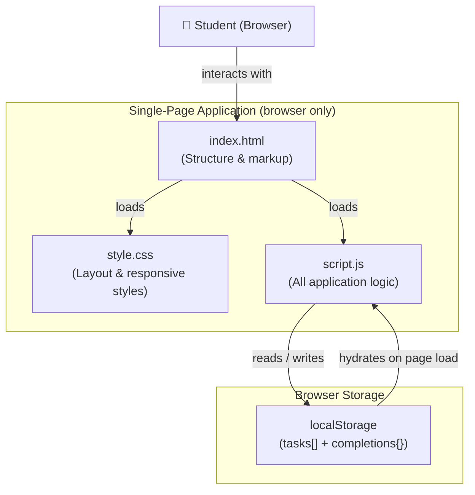

# Design Document: Study Planner

## Overview

The Study Planner is a single-page web application (SPA) that runs entirely in the browser. Students capture subjects, topics, exam dates, and available study hours; the app persists everything in **LocalStorage** and produces a prioritised daily timetable on demand.

**Technology constraints** (hard requirements from Requirement 7):
- Three files only: `index.html`, `style.css`, `script.js`
- Pure HTML5, CSS3, and Vanilla JavaScript — zero external libraries, frameworks, or backend calls
- All persistence via the browser's `localStorage` API

Because there is no build step, no bundler, and no server, the design intentionally avoids module systems, classes, or async patterns that would require transpilation. Every function is a plain function declaration at the top level of `script.js`.

---

## Architecture



All data flow is synchronous:
1. The page loads → `script.js` reads LocalStorage → DOM is hydrated.
2. The student interacts → an event handler fires → state is mutated → LocalStorage is written → the DOM is re-rendered.

There is no routing, no virtual DOM, and no state management library. DOM re-renders are done by rebuilding the relevant section's `innerHTML`.

---

## Components and Interfaces

### Page Sections (HTML)

The page is divided into four permanent sections rendered in this top-to-bottom order:

| Section | HTML `id` | Purpose |
|---|---|---|
| Header | `#header` | App title "Study Planner" |
| Dashboard | `#dashboard` | Three counters: Total / Completed / Remaining |
| Input Form | `#task-form` | Four fields + Add Task button |
| Task List | `#task-list` | Rendered task cards with Delete buttons |
| Study Plan | `#study-plan` | Generated schedule blocks with Completed buttons |

### JavaScript Function Interfaces

Each function has a single, well-defined responsibility:

```
addTask()
  Reads form values → validates → creates Task object → appends to tasks[]
  → saves to LocalStorage → re-renders task list → clears form → updates Dashboard

deleteTask(taskId)
  Shows confirmation prompt → on confirm: removes Task from tasks[]
  → saves to LocalStorage → re-renders task list → updates Dashboard

generateStudyPlan()
  Reads tasks[] → sorts by examDate ASC (then insertion order)
  → calls buildScheduleBlocks(tasks) → renders Schedule_Blocks → updates Dashboard

markCompleted(blockKey)
  Toggles completions[blockKey] boolean → saves to LocalStorage
  → applies / removes visual style on block element → updates Dashboard

updateDashboard()
  Reads tasks[] and completions{} → recalculates counters
  → updates three counter elements in #dashboard

loadFromStorage()
  Called once on DOMContentLoaded → reads 'sp_tasks' and 'sp_completions'
  from LocalStorage → populates tasks[] and completions{}
  → re-renders task list and study plan → updates Dashboard

buildScheduleBlocks(sortedTasks)  [pure helper — no DOM side-effects]
  Receives sorted task array → applies scheduling algorithm
  → returns array of Schedule_Block objects

renderTaskList()
  Reads tasks[] → rebuilds #task-list innerHTML

renderStudyPlan(blocks)
  Receives Schedule_Block array → rebuilds #study-plan innerHTML
  → restores completed styles from completions{}

validateForm()  [pure helper]
  Reads form fields → returns { valid: boolean, errors: string[] }

showValidationErrors(errors)
  Receives error list → renders inline messages next to each field

clearForm()
  Resets all four form fields to their default empty / placeholder state
```

### Event Bindings

| Event | Target | Handler |
|---|---|---|
| `DOMContentLoaded` | `document` | `loadFromStorage` |
| `submit` | `#task-form` | `addTask` |
| `click` | `.delete-btn` (delegated from `#task-list`) | `deleteTask(taskId)` |
| `click` | `#generate-btn` | `generateStudyPlan` |
| `click` | `.complete-btn` (delegated from `#study-plan`) | `markCompleted(blockKey)` |

Event delegation is used for dynamically created Delete and Completed buttons to avoid re-binding listeners on every render.

---

## Data Models

### In-Memory State

Two module-level variables hold all runtime state:

```js
let tasks = [];         // Array<Task>  — ordered by insertion time
let completions = {};   // Record<string, boolean>  — blockKey → true/false
```

### Task Object

```js
{
  id: string,           // crypto.randomUUID() or Date.now().toString() fallback
  subject: string,      // max 100 chars
  topic: string,        // max 100 chars
  examDate: string,     // ISO-8601 date string "YYYY-MM-DD"
  hours: number         // 0.5 – 24 (float)
}
```

### Schedule_Block Object

Generated at runtime by `buildScheduleBlocks`; never persisted to LocalStorage.

```js
{
  blockKey: string,     // "<taskId>-<blockIndex>" — unique per block, stable for same task set
  taskId: string,
  subject: string,
  topic: string,
  startTime: string,    // "HH:MM" (24-hour)
  endTime: string,      // "HH:MM" (24-hour)
  date: string          // "YYYY-MM-DD" — the calendar day this block falls on
}
```

### LocalStorage Keys

| Key | Type | Content |
|---|---|---|
| `sp_tasks` | JSON string | `Task[]` — full tasks array |
| `sp_completions` | JSON string | `Record<string, boolean>` — completed block keys |

**Design decision:** Tasks and completions are stored under separate keys. This means toggling a completion never rewrites the entire tasks array — reducing the risk of data loss on write failure.

### Validation Rules (enforced in `validateForm`)

| Field | Rule |
|---|---|
| Subject Name | Required; max 100 chars |
| Topic Name | Required; max 100 chars |
| Exam Date | Required; must be today or a future date (compare to `new Date().toISOString().slice(0,10)`) |
| Available Study Hours | Required; numeric; 0.5 ≤ value ≤ 24 |

### Scheduling Algorithm (`buildScheduleBlocks`)

```
Input:  tasks[] already sorted by examDate ASC, then insertion order ASC
Output: Schedule_Block[]

cursor = { date: today, minutes: 09*60 }   // 09:00 on today's date

for each task in sortedTasks:
  if task.hours === 0 → skip (Req 4.5)

  startMinutes = cursor.minutes
  endMinutes   = startMinutes + task.hours * 60

  if endMinutes > 23*60 + 59:             // block would exceed 23:59
    cursor.date = nextDay(cursor.date)
    cursor.minutes = 09*60
    startMinutes = cursor.minutes
    endMinutes   = startMinutes + task.hours * 60

  emit Schedule_Block {
    startTime = minutesToHHMM(startMinutes),
    endTime   = minutesToHHMM(endMinutes),
    date      = cursor.date,
    ...
  }

  cursor.minutes = endMinutes             // next block follows immediately
```

**Key design decisions:**
- Blocks are contiguous; there are no gaps between subjects within a day.
- A single task is never split across days (the entire block is placed on the next day if it doesn't fit).
- The schedule always starts at 09:00; re-running `generateStudyPlan` on the same task set produces the same output (deterministic).

---

## Correctness Properties

*A property is a characteristic or behavior that should hold true across all valid executions of a system — essentially, a formal statement about what the system should do. Properties serve as the bridge between human-readable specifications and machine-verifiable correctness guarantees.*

### Property 1: LocalStorage round-trip preserves all data

*For any* array of valid Task objects and any map of completion states, serialising both to LocalStorage (as `sp_tasks` and `sp_completions`) and then deserialising them via `loadFromStorage` shall produce arrays and maps that are deeply equal to the originals — preserving all field values, insertion order, and completion states.

**Validates: Requirements 2.1, 2.3, 2.4, 5.4**

---

### Property 2: `validateForm` rejects any invalid input

*For any* combination of form field values where at least one field is empty, whitespace-only, has more than 100 characters, has `hours` outside [0.5, 24], or has an `examDate` earlier than today, `validateForm` shall return `valid: false` and the tasks array shall remain unchanged after the attempted submission.

**Validates: Requirements 1.2, 1.3, 1.4, 1.6, 2.5**

---

### Property 3: Every task's rendered card contains all four fields

*For any* non-empty array of saved Tasks, the HTML produced by `renderTaskList` shall contain, for each Task, a visible representation of its `subject`, `topic`, `examDate` (formatted DD/MM/YYYY), and `hours` values.

**Validates: Requirements 2.2**

---

### Property 4: Task insertion order is preserved across saves and loads

*For any* sequence of tasks added one-by-one, saving to LocalStorage and reloading shall always restore the tasks in exactly the same order they were originally inserted.

**Validates: Requirements 2.4**

---

### Property 5: Scheduling algorithm produces correct, contiguous time blocks

*For any* non-empty list of valid tasks (none with `hours = 0`), the Schedule_Blocks produced by `buildScheduleBlocks` shall satisfy all of the following simultaneously:
- The very first block starts at exactly `09:00`.
- On any given calendar day, consecutive blocks are contiguous: each block's `startTime` equals the previous block's `endTime`.
- No block extends past `23:59` on its assigned day (if it would, it is moved in its entirety to the next day starting at `09:00`).
- Each block's duration in minutes equals `task.hours × 60`.
- Tasks are processed in ascending `examDate` order (ties broken by insertion order).

**Validates: Requirements 4.3, 4.4, 4.6**

---

### Property 6: Dashboard counters are always consistent with state

*For any* sequence of add-task, delete-task, and toggle-completion operations applied in any order, the Dashboard counters shall always satisfy: `Remaining = Total − Completed`, where `Total` equals `tasks.length` and `Completed` equals the number of tasks that have at least one block key present in `completions`.

**Validates: Requirements 6.2, 6.3**

---

### Property 7: Completion toggle is an involution

*For any* Schedule_Block key and any initial completion state, toggling the block twice (completed → incomplete) shall restore `completions[blockKey]` to its original value, with no change to any other key in the completions map.

**Validates: Requirements 5.2, 5.3**

---

### Property 8: Deleting a task removes it from all storage and rendering

*For any* task present in `tasks[]`, after `deleteTask(taskId)` is confirmed, that task's `id` shall not appear in `tasks[]`, in LocalStorage (`sp_tasks`), or in any rendered task-list element — regardless of how many other tasks are present before or after it.

**Validates: Requirements 3.3, 3.5**

---

## Error Handling

| Scenario | Behaviour |
|---|---|
| Form submitted with empty field | Inline validation message shown adjacent to offending field; Task not saved |
| Hours outside 0.5–24 | Validation message states allowed range; Task not saved |
| Exam Date in the past | Validation message states date must be today or future; Task not saved |
| Subject or Topic > 100 chars | Input capped at 100 chars via `maxlength` attribute; validation message shown |
| Generate Plan with no tasks | Message "No tasks available to generate a plan." displayed in #study-plan |
| LocalStorage read fails on page load | All counters default to 0; all blocks render as incomplete; error banner displayed |
| LocalStorage write fails (e.g., quota exceeded) | `try/catch` around every `localStorage.setItem` call; user shown a non-blocking error toast |

All error messages are inline (adjacent to the relevant field or section) to avoid disruptive modal dialogs.

---

## Testing Strategy

### Unit Tests

Unit tests cover specific examples, edge cases, and error conditions in pure functions. The recommended framework is **Jest** (or a zero-config alternative like **uvu** if keeping things minimal), run via Node without a browser.

Pure helpers suitable for unit testing:

| Function | What to test |
|---|---|
| `validateForm` | Empty fields, whitespace-only strings, hours=0.4 / 0.5 / 24 / 24.1, past date, today's date |
| `buildScheduleBlocks` | Empty array returns `[]`; single task produces one block starting 09:00; two tasks produce contiguous blocks; cumulative hours > 15 triggers day rollover at 09:00 next day; task with hours=0 is skipped |
| Task serialisation | `JSON.stringify` + `JSON.parse` round-trip preserves all field values |

### Property-Based Tests

Property-based tests validate universal properties across randomly generated inputs. The recommended library is **[fast-check](https://github.com/dubzzz/fast-check)** (JavaScript, zero-config, works in Node).

Each property test is configured to run a **minimum of 100 iterations**.

| Property | Test description | `fast-check` arbitraries |
|---|---|---|
| Property 1: LocalStorage round-trip | Generate random valid task arrays + completion maps → serialize to JSON → deserialize → assert deep equality | `fc.array(validTaskArb)`, `fc.dictionary(fc.string(), fc.boolean())` |
| Property 2: validateForm rejects invalid inputs | Generate combinations of fields where at least one is empty / whitespace-only / >100 chars / out-of-range hours / past date → assert `valid === false` and tasks[] unchanged | `fc.record({...})` with filtered invalid fields |
| Property 3: Task cards contain all four fields | Generate 1–20 valid tasks → call `renderTaskList` → assert rendered HTML contains subject, topic, formatted date, hours for each task | `fc.array(validTaskArb, {minLength:1, maxLength:20})` |
| Property 4: Insertion order preserved | Generate ordered task arrays → save to LocalStorage → load via `loadFromStorage` → assert order unchanged | `fc.array(validTaskArb, {minLength:1})` |
| Property 5: Scheduling algorithm correctness | Generate 1–20 valid tasks → call `buildScheduleBlocks` → assert: first block = 09:00, consecutive blocks contiguous, no block past 23:59 on its day, each duration = hours×60, output sorted by examDate ASC | `fc.array(validTaskArb, {minLength:1, maxLength:20})` |
| Property 6: Dashboard counter consistency | Generate random sequences of add/delete/toggle operations → assert `Remaining = Total − Completed` after each step | `fc.commands([addCmd, deleteCmd, toggleCmd])` (model-based) |
| Property 7: Completion toggle is involution | Generate a blockKey + initial completions map → toggle twice → assert map equals original | `fc.string()` for blockKey, `fc.dictionary(...)` for initial state |
| Property 8: Delete removes from all storage | Generate task array → pick random task to delete → assert task absent from tasks[], LocalStorage, and rendered HTML | `fc.array(validTaskArb, {minLength:1})` + `fc.integer(...)` index |

Tag format for each property test:
```
// Feature: study-planner, Property N: <property_text>
```

### Integration / Manual Tests

Because the app runs entirely in a browser without a server, full integration testing is done manually:

- Load `index.html` in Chrome, Firefox, and Safari (mobile viewport simulation)
- Verify responsive layout at 375 px, 600 px, and 1280 px widths
- Verify LocalStorage persistence across page refresh
- Verify Dashboard updates within 500 ms (stopwatch check)
- Verify form field `maxlength` capping at 100 characters
